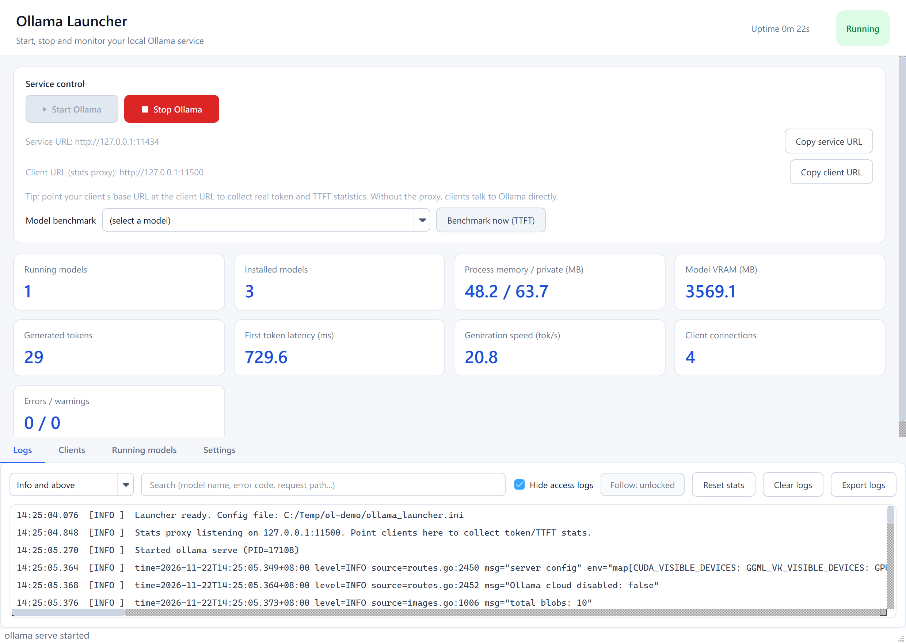
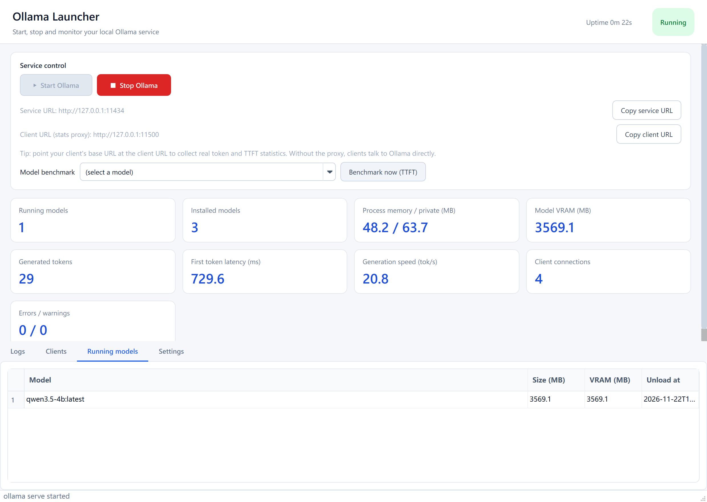
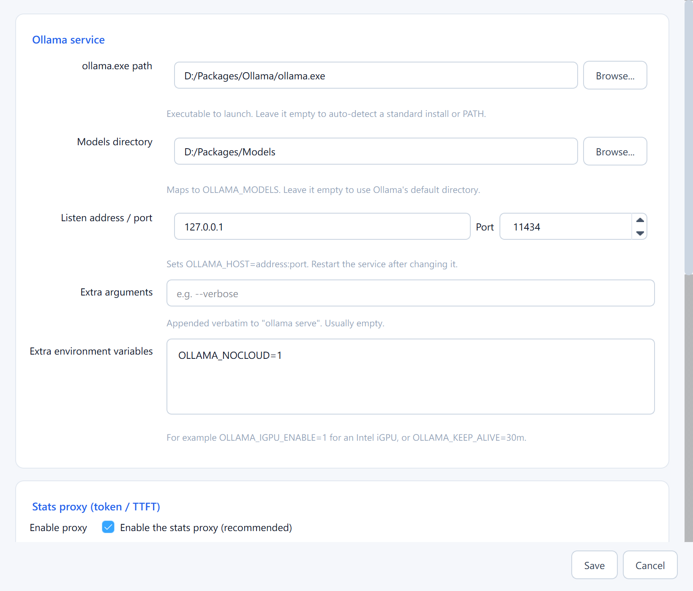
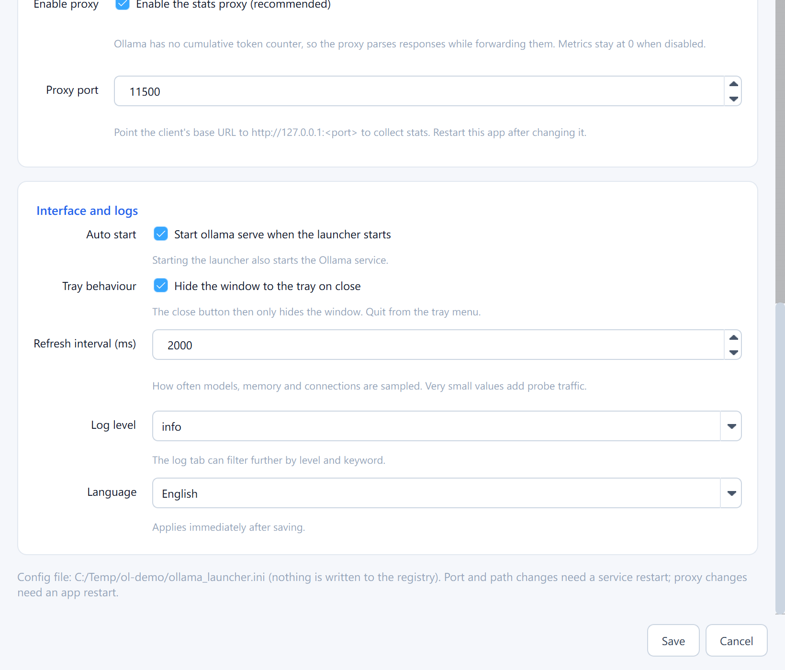

# Ollama Launcher

A small Windows tray application that starts, stops and monitors a local
[Ollama](https://ollama.com) server. It is aimed at people who run Ollama on
their own machine and want to see what it is doing — memory, VRAM, generated
tokens, first-token latency, connected clients and the server log — without
opening a terminal.

English and Simplified Chinese UI, switchable at runtime.



## Features

- **Service control** — start and stop `ollama serve` with one click. The whole
  process tree is terminated on exit, so no orphan process keeps the port or the
  VRAM.
- **Tray resident** — closing the window only hides it. A second launch focuses
  the existing instance instead of starting another copy (single instance via a
  named pipe).
- **Live metrics** — running and installed models, working-set/private memory,
  model VRAM, generated tokens, first-token latency, generation speed, client
  connections and an error/warning counter.
- **Log viewer** — colour-coded levels, filters by level and keyword, hides
  `[GIN]` access noise, multi-select copy, export to a text file, and a
  follow-latest lock that releases itself when you scroll up.
- **Connected clients** — established TCP connections to the Ollama port, with
  the owning process name and full executable path.
- **Running models** — model size, VRAM footprint and the auto-unload time
  reported by `/api/ps`.
- **TTFT benchmark** — measures time-to-first-token with any installed model,
  using a short 8-token generation.
- **Statistics proxy** — an optional local reverse proxy that reads the streamed
  NDJSON to accumulate real token counts, TTFT and tok/s. See
  [How the statistics work](#how-the-statistics-work).
- **Settings dialog** — every option of the ini file, plus the interface
  language. Applied without editing files by hand.
- **No side effects** — nothing is written to the registry, no system
  environment variable is modified, and the app never downloads anything.

## Screenshots

| Running models | Settings |
| --- | --- |
|  |  |

## Requirements

- Windows 10 or 11 (x64). The process and TCP inspection uses Win32 APIs; other
  platforms compile but show no local metrics.
- Qt 6.2+ (Widgets, Network). Qt 5.15 is supported on a best-effort basis.
- CMake 3.16+ and a C++17 compiler (MSVC 2019+ or MinGW 11+).
- A local Ollama installation.

## Build

```bash
cmake -S . -B build -DCMAKE_BUILD_TYPE=Release \
      -DCMAKE_PREFIX_PATH=C:/Qt/6.8.3/mingw_64
cmake --build build
```

The executable ends up in `build/bin/ollama_launcher.exe`. Copy the Qt runtime
next to it with the `windeployqt` that belongs to the same Qt kit:

```bash
C:/Qt/6.8.3/mingw_64/bin/windeployqt --release build/bin/ollama_launcher.exe
```

`-DOL_CONSOLE=ON` attaches a console window, which is handy while debugging.
More details in [docs/BUILD.md](docs/BUILD.md).

## Usage

1. Start `ollama_launcher.exe`. On the first run it looks for `ollama.exe` in
   the standard install locations and on `PATH`, then writes
   `ollama_launcher.ini` next to the executable.
2. Press **Start Ollama** (or enable *Auto start* in the settings).
3. The tray icon shows the state: green dot while the server is running, grey
   while it is stopped. Double-click opens the window, right-click has the
   start/stop/quit actions.

Command-line options:

| Option | Meaning |
| --- | --- |
| `--minimized` | start hidden in the tray |
| `--no-proxy` | do not start the statistics proxy |
| `--config <path>` | use a specific ini file |
| `--quit` | ask the running instance to quit |
| `--no-tray-check` | skip the "no system tray" warning |

## How the statistics work

Ollama has no endpoint that returns *cumulative* generated tokens or a global
TTFT, but every generate response carries `eval_count`, `eval_duration` and
`prompt_eval_duration`. The launcher therefore ships a small reverse proxy: point
your client's base URL at the proxy port instead of the Ollama port, and the
proxy forwards each request unchanged while parsing the streamed NDJSON.

```
client -> 127.0.0.1:11500 (proxy) -> 127.0.0.1:11434 (ollama)
```

```bash
curl http://127.0.0.1:11500/api/generate \
     -d '{"model":"llama3.2","prompt":"hi","stream":true}'
curl http://127.0.0.1:11500/__stats
```

`GET /__stats` returns the current counters as JSON, which is convenient when
you want to check the proxy from a script:

```json
{"requests":1,"promptTokens":24,"generatedTokens":27,
 "lastTtftMs":769.9,"avgTtftMs":769.9,"lastTokensPerSec":18.9,"active":0}
```

If you do not need the numbers, disable the proxy in the settings and let
clients talk to Ollama directly — every other metric keeps working.

## Language

The interface ships in English (default) and Simplified Chinese. Pick the
language in *Settings → Interface language*; the choice is stored in
`ollama_launcher.ini` and applied immediately, without a restart.



## Configuration

`ollama_launcher.ini` lives next to the executable. The settings dialog edits
the same file; the table below is for reference.

| Key | Default | Description |
| --- | --- | --- |
| `server/ollama_path` | auto-detected | absolute path of `ollama.exe` |
| `server/models_dir` | `%USERPROFILE%\.ollama\models` | passed as `OLLAMA_MODELS` |
| `server/host` | `127.0.0.1` | listen address (`OLLAMA_HOST`) |
| `server/port` | `11434` | Ollama port |
| `server/extra_args` | empty | appended to `ollama serve` |
| `env/<KEY>` | `OLLAMA_NOCLOUD=1` | extra environment variables for the child process |
| `proxy/enabled` | `true` | enable the statistics proxy |
| `proxy/port` | `11500` | proxy port, must differ from the Ollama port |
| `ui/auto_start` | `false` | start the service together with the launcher |
| `ui/close_to_tray` | `true` | closing the window hides it |
| `ui/refresh_ms` | `2000` | monitor polling interval |
| `ui/log_level` | `info` | `debug`, `info`, `warn` or `error` |
| `ui/language` | `en` | `en` or `zh` |

## Project layout

```
include/<module>/   public headers of each module
src/<module>/       implementation
resources/          icon, style sheet, ini template, Windows resource script
docs/               build notes and screenshots
```

The executable is a single target and every module directory is added to its
include path, so sources include headers by plain file name
(`#include "app_config.h"`) and never use `../` path escapes:

```
core      configuration, single instance, translation table
platform  read-only Win32 process and TCP inspection
process   ollama serve lifecycle and log classification
monitor   HTTP polling and the TTFT probe
proxy     token/TTFT statistics proxy
ui        main window, settings dialog, tray, log model
```

## Limitations

- Windows only in practice: memory and connection metrics rely on
  `GetProcessMemoryInfo` and `GetExtendedTcpTable`.
- The statistics proxy speaks plain HTTP on localhost and is not meant to be
  exposed to a network.
- Tokens are counted from the generate responses that pass through the proxy;
  requests sent directly to port 11434 are not counted.

## Disclaimer

This is an independent community tool. It is not affiliated with, endorsed by or
supported by the Ollama project. "Ollama" is used only to describe what the
application manages.

## Contributing

Bug reports and pull requests are welcome — see [CONTRIBUTING.md](CONTRIBUTING.md).

## License

[MIT](LICENSE)
