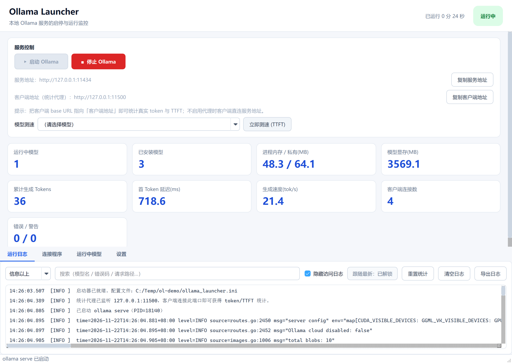
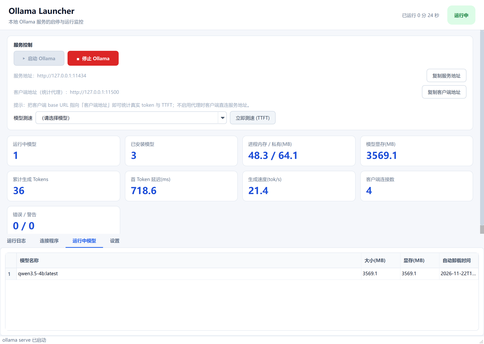
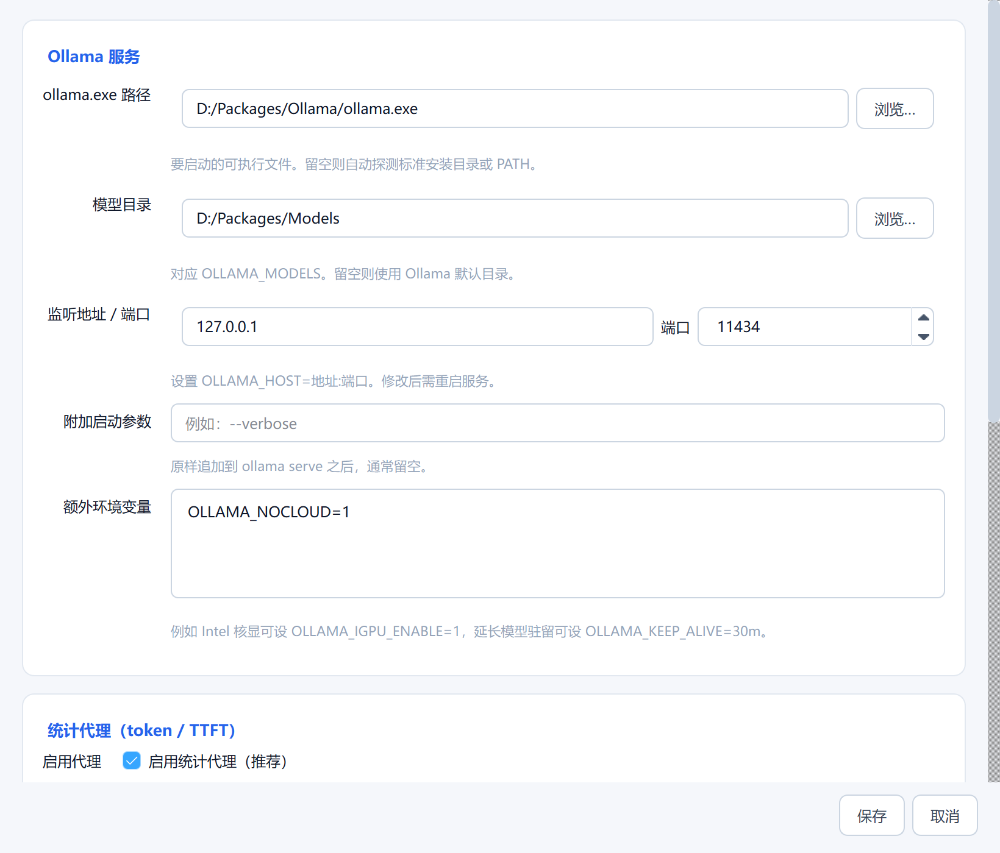
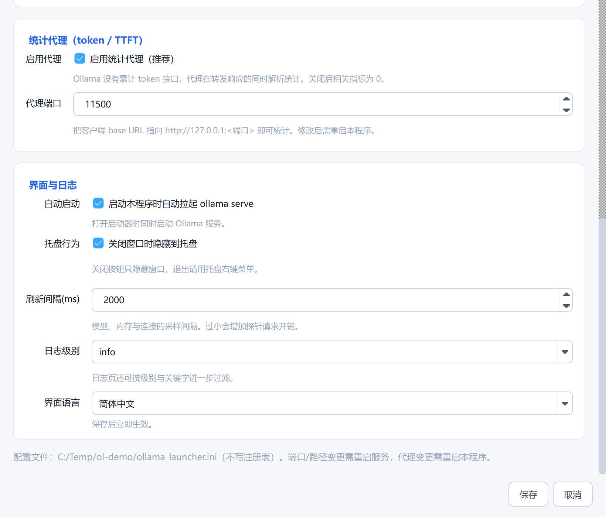

# Ollama Launcher

一个用于启动、停止并监控本机 [Ollama](https://ollama.com) 服务的 Windows
托盘小程序。面向在本机运行 Ollama 的用户：不打开终端也能看到服务状态、内存与
显存占用、累计 token、首 token 延迟、客户端连接和运行日志。

界面支持简体中文与英文，运行时可切换。



## 功能

- **服务控制** — 一键启动 / 停止 `ollama serve`。退出程序时结束整个进程树，
  不会留下占用端口和显存的孤儿进程。
- **托盘常驻** — 关闭窗口只隐藏到托盘；重复双击只唤起已有窗口，不会启动第二个
  实例（基于命名管道的单实例机制）。
- **实时指标** — 运行中 / 已安装模型数、进程工作集与私有内存、模型显存、累计
  生成 token、首 token 延迟、生成速度、客户端连接数、错误 / 警告计数。
- **日志查看** — 按级别着色；可按级别与关键字过滤；可隐藏 `[GIN]` 访问日志；
  支持多选复制、导出为文本；「跟随最新」锁定后自动滚动，向上滚动自动解锁。
- **连接程序** — 列出连到 Ollama 端口的已建立连接，并显示对应进程名与可执行
  文件路径。
- **运行中模型** — 模型大小、显存占用和 `/api/ps` 给出的自动卸载时间。
- **TTFT 测速** — 用任意已安装模型做一次 8 token 的极短生成，测量首 token 延迟。
- **统计代理** — 可选的本地反向代理，通过解析流式 NDJSON 统计真实 token 数、
  TTFT 和 tok/s，详见下文。
- **设置对话框** — 覆盖 ini 中的全部配置项，并可切换界面语言，无需手工改文件。
- **无副作用** — 不写注册表、不修改系统环境变量，也不联网下载任何东西。

## 截图

| 运行中模型 | 设置 |
| --- | --- |
|  |  |

## 环境要求

- Windows 10 / 11（x64）。进程与 TCP 信息依赖 Win32 API；其他平台可以编译，
  但本地指标为空。
- Qt 6.2+（Widgets、Network）；Qt 5.15 为尽力支持，未做完整验证。
- CMake 3.16+ 与支持 C++17 的编译器（MSVC 2019+ 或 MinGW 11+）。
- 本机已安装 Ollama。

## 编译

```bash
cmake -S . -B build -DCMAKE_BUILD_TYPE=Release \
      -DCMAKE_PREFIX_PATH=C:/Qt/6.8.3/mingw_64
cmake --build build
```

产物为 `build/bin/ollama_launcher.exe`。用**同一套 Qt** 的 `windeployqt` 把
运行库拷到旁边：

```bash
C:/Qt/6.8.3/mingw_64/bin/windeployqt --release build/bin/ollama_launcher.exe
```

加 `-DOL_CONSOLE=ON` 会附带控制台窗口，便于调试。更多细节见
[docs/BUILD.md](docs/BUILD.md)。

## 使用

1. 运行 `ollama_launcher.exe`。首次启动会在常见安装目录和 `PATH` 中查找
   `ollama.exe`，并在 exe 同目录生成 `ollama_launcher.ini`。
2. 点击「启动 Ollama」（或在设置中勾选「自动启动」）。
3. 托盘图标显示状态：运行中为绿点，已停止为灰点。双击打开窗口，右键菜单可
   启动 / 停止 / 退出。

命令行参数：

| 参数 | 含义 |
| --- | --- |
| `--minimized` | 启动时只驻留托盘 |
| `--no-proxy` | 不启动统计代理 |
| `--config <path>` | 指定 ini 文件 |
| `--quit` | 让正在运行的实例退出 |
| `--no-tray-check` | 跳过「未检测到托盘」提示 |

## 统计是怎么来的

Ollama 没有查询「累计生成 token」或「全局 TTFT」的接口，但每次生成响应里都带
`eval_count`、`eval_duration` 和 `prompt_eval_duration`。因此程序内置了一个
本地反向代理：把客户端的 base URL 指向代理端口，代理原样转发请求，同时解析
返回的流式 NDJSON 并累计统计。

```
客户端 -> 127.0.0.1:11500（代理） -> 127.0.0.1:11434（Ollama）
```

```bash
curl http://127.0.0.1:11500/api/generate \
     -d '{"model":"llama3.2","prompt":"hi","stream":true}'
curl http://127.0.0.1:11500/__stats
```

`GET /__stats` 会返回当前计数，便于脚本读取：

```json
{"requests":1,"promptTokens":24,"generatedTokens":27,
 "lastTtftMs":769.9,"avgTtftMs":769.9,"lastTokensPerSec":18.9,"active":0}
```

如果不需要这些数字，在设置中关闭代理、让客户端直连 Ollama 即可，其余指标不受
影响。

## 界面语言

界面提供英文（默认）与简体中文两套文案。在「设置 → 界面语言」中切换，选择会
保存到 `ollama_launcher.ini` 并立即生效，无需重启。



## 配置

`ollama_launcher.ini` 位于 exe 同目录。设置对话框编辑的也是这个文件，下表供
手工修改时参考。

| 键 | 默认值 | 说明 |
| --- | --- | --- |
| `server/ollama_path` | 自动探测 | `ollama.exe` 的绝对路径 |
| `server/models_dir` | `%USERPROFILE%\.ollama\models` | 作为 `OLLAMA_MODELS` 传入 |
| `server/host` | `127.0.0.1` | 监听地址（`OLLAMA_HOST`） |
| `server/port` | `11434` | Ollama 端口 |
| `server/extra_args` | 空 | 追加到 `ollama serve` 之后 |
| `env/<KEY>` | `OLLAMA_NOCLOUD=1` | 注入子进程的额外环境变量 |
| `proxy/enabled` | `true` | 是否启用统计代理 |
| `proxy/port` | `11500` | 代理端口，不能与 Ollama 端口相同 |
| `ui/auto_start` | `false` | 启动本程序时自动拉起服务 |
| `ui/close_to_tray` | `true` | 关闭窗口时隐藏到托盘 |
| `ui/refresh_ms` | `2000` | 监控轮询间隔 |
| `ui/log_level` | `info` | `debug` / `info` / `warn` / `error` |
| `ui/language` | `en` | `en` 或 `zh` |

## 目录结构

```
include/<模块>/   各模块的公共头文件
src/<模块>/       实现代码
resources/        图标、样式表、ini 模板、Windows 资源脚本
docs/             编译说明与截图
```

可执行文件是单一目标，各模块的头文件目录都加入它的包含路径，因此源码中直接
`#include "app_config.h"`，不出现 `../` 之类的路径跳转。

```
core      配置、单实例、翻译表
platform  只读的 Win32 进程与 TCP 查询
process   ollama serve 生命周期与日志分级
monitor   HTTP 轮询与 TTFT 探针
proxy     token / TTFT 统计代理
ui        主窗口、设置对话框、托盘、日志模型
```

## 已知限制

- 实际上是 Windows 专用：内存与连接指标依赖 `GetProcessMemoryInfo` 和
  `GetExtendedTcpTable`。
- 统计代理只在本机监听明文 HTTP，不适合暴露到网络。
- token 只统计经过代理的请求；直连 11434 端口的请求不会被计入。

## 免责声明

本项目是独立的社区工具，与 Ollama 官方无任何关联，也未获其认可或支持。
文中的「Ollama」仅用于说明本程序管理的对象。

## 参与贡献

欢迎提交问题与改进，详见 [CONTRIBUTING.md](CONTRIBUTING.md)。

## 许可证

[MIT](LICENSE)
